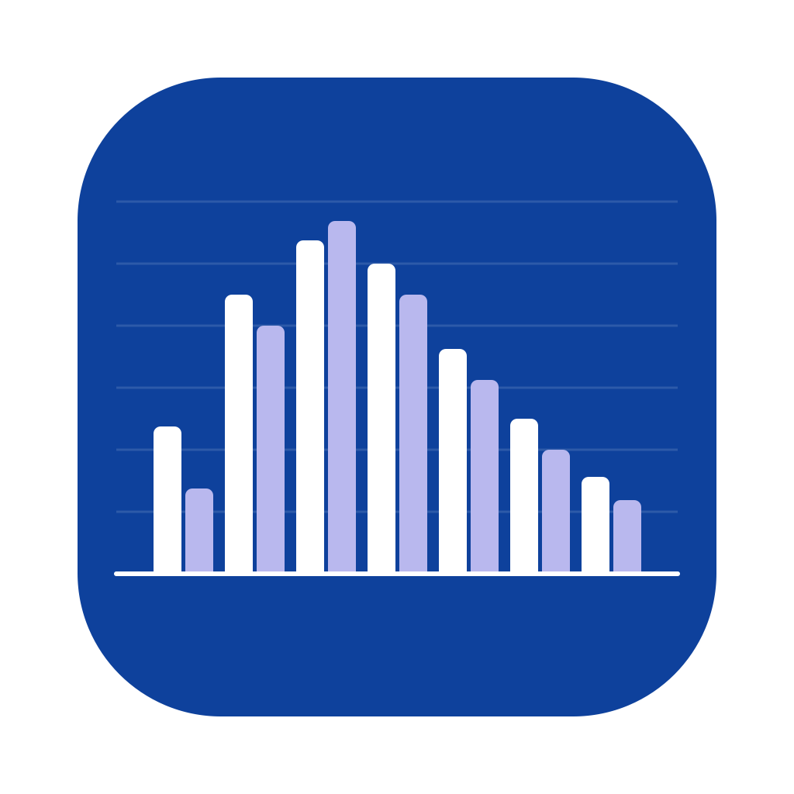

# Linguistic Feature Registry · 英语语言指标目录

An English-first registry of linguistic measures for quantitative linguistics, distribution fitting, and explanatory or predictive modeling. The registry records definitions, operational variants, sources, and external-resource choices.

以英语为主的语言指标目录，服务于计量语言学规律拟合及解释／预测建模。每项指标保留定义、观察单位、提取入口、来源和测量限制，并为跨语言扩展预留口径说明。

**Research snapshot / 检索快照：2026-10-14（Asia/Taipei）**

| 内容 | 数量 | 计数含义 |
| --- | ---: | --- |
| 指标目录 | 177 | 包含单项、指标族、拟合对象及质控量 |
| 指标类别 | 17 | 内容分类 |
| 论文中的具体操作化 | 44 | 通过 `feature_id` 关联目录，包含方向、聚合和版本变体 |
| 外部资源选型 | 25 | 实施优先级、资源选择、缺失处理与启用条件 |
| 来源记录 | 73 | 工具文档、论文、勘误、常模与模型说明等 |

177 条目录与 44 项操作化不能直接相加为独立指标数。目录条目数也不代表独立构念数或软件输出列数。

## LingMetrics Mac 应用



仓库现在包含 LingMetrics 0.1.2 组内测试应用：原生界面、自带基础环境、TXT/CSV 输入、进度与断点续算，以及可追溯的研究资料导出。适用于 Apple Silicon、macOS 13 及以上。

全库177个条目均有入口，默认常用组合61个条目。模型与参照资源按需准备；3个目录条目及部分操作化细节保留方法待核状态。具体覆盖以[执行清单](metadata/execution_manifest.json)和每次运行状态为准。

- [使用手册](docs/extractor.md)与[资源格式](docs/resources.md)。
- [验证记录](docs/validation.md)：区分公式测试、软件试跑、性能检查和目标语料效度。
- [速度优化与复测](docs/performance.md)：保留公式、抽样及上下文口径，并记录逐项计时。
- 源码构建：`python3 scripts/build_macos.py`；组员直接使用打包应用，无需Python。
- 自动构建的安装包可从本仓库 GitHub Actions 的 `LingMetrics-arm64` 制品下载；本地构建在 `dist/`。

## 下载与浏览

- [完整 Excel 工作簿](downloads/english_linguistic_feature_registry_20261014.xlsx)：五个工作表，包含筛选按钮及冻结表头。
- [指标总目录 CSV](data/english_linguistic_feature_registry.csv)：177 条目录记录。
- [论文操作化 CSV](data/paper_measure_specifications.csv)：44 项公式、分母、聚合及版本细节。
- [资源选型 CSV](data/external_resource_selection.csv)：25 项资源决策。
- [来源目录 CSV](data/sources.csv)／[可浏览来源索引](docs/sources.md)。
- [使用与建模说明 CSV](data/modeling_guidance.csv)。

CSV 使用 UTF-8 BOM 和带引号字段。字段内可能包含换行，应使用标准 CSV 读取器；Python 可指定 `encoding="utf-8-sig"`。

## 阅读路径

1. 在总目录中找到指标的 `feature_id` 和测量层级。
2. 在论文操作化表中核对同名方法的公式、分母、方向、参数及原文位置。
3. 参考[资源选型](docs/resource_selection.md)，确定外部词表、常模、向量或语言模型。
4. 读[数据字典](docs/data_dictionary.md)和[测量与建模原则](docs/methodology.md)，再确定执行配置。

## 当前资源建议

可解释词汇指标优先采用 SUBTLEX-US、Kuperman AoA 和 Brysbaert 等人的具体性常模；wordfreq 作为平行复核。学术词表、感知运动、情绪及形态词典按问题启用。

句间语义相似度选用 `sentence-transformers/all-mpnet-base-v2` 作为待校准的新实现；词级分布语义按需采用 fastText `cc.en.300.bin`。因果模型评分选用 `EleutherAI/pythia-410m-deduped` 的固定 checkpoint 作为基线候选。选择理由详见资源表，资源文件版本、提交和哈希需在取得实际文件后补全。

## 范围与状态

This research snapshot is an inventory and measurement guide. The accompanying Mac extractor has software and formula checks; target-corpus validity and empirical modeling claims require separate evaluation.

本项目已核对来源和部分方法段，并区分全文、摘要、元数据及工具文档等证据范围。应用的公式、文件流程和部分真实模型已另行验证；常模和指标在目标研究语料上的效度仍需校准。目录一致性和软件试跑均不能替代语言指标效度验证。

书面英语为主；尚未全面覆盖真实语音韵律、会话互动、多模态和需要人工判断的语用功能。跨语言说明是迁移边界，不能据此认定其他语言已获验证。

仓库包含整理后的目录与说明；第三方词表、语料、模型权重和论文全文通过来源链接访问。

## 类别覆盖

| 类别 | 目录条目数 |
| --- | --- |
| 01 基础长度与规模 | 9 |
| 02 词汇多样性 | 14 |
| 03 词汇频率与熟练度 | 10 |
| 04 多词单位与搭配 | 8 |
| 05 词汇语义与心理常模 | 12 |
| 06 形态结构 | 8 |
| 07 词性与语法分布 | 10 |
| 08 句法复杂度与构式 | 25 |
| 09 依存与树结构 | 16 |
| 10 篇章衔接与语义相似度 | 12 |
| 11 信息论与语言模型 | 10 |
| 12 可读性复合分数 | 9 |
| 13 文体语域与语用代理量 | 7 |
| 14 正字法与词典音系 | 6 |
| 15 计量规律与分布拟合 | 11 |
| 16 错误与语料质量诊断 | 5 |
| 17 词汇共现网络 | 5 |

## 本地校验

需要 Python 3，使用标准库，无需安装 NLP 包。

```bash
python3 scripts/validate_registry.py
```

校验包括：标识符唯一性、来源与指标关联、声明数量、CSV 与 Excel 值一致性、发布文件哈希。结果只说明文件和目录结构一致。

## 扩充规则

- 新增指标先记录定义、观察单位和来源；同名方法不自动合并。
- 公式、分母、token／lemma、窗口、聚合、标注方案或模型变化，需要明确登记版本。
- 保留“提出、后续使用、修正、复现和迁移建议”的区别。
- 新增条目后同步来源、操作化、选型、元数据和 Excel 快照，再执行校验。

引用本目录时可注明仓库 URL、研究快照日期及所用 commit，以便定位具体版本。原指标和资源仍应引用对应来源。
